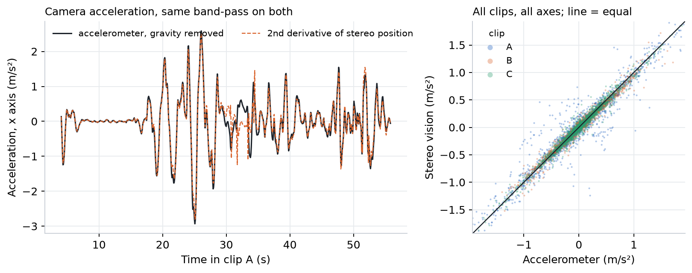
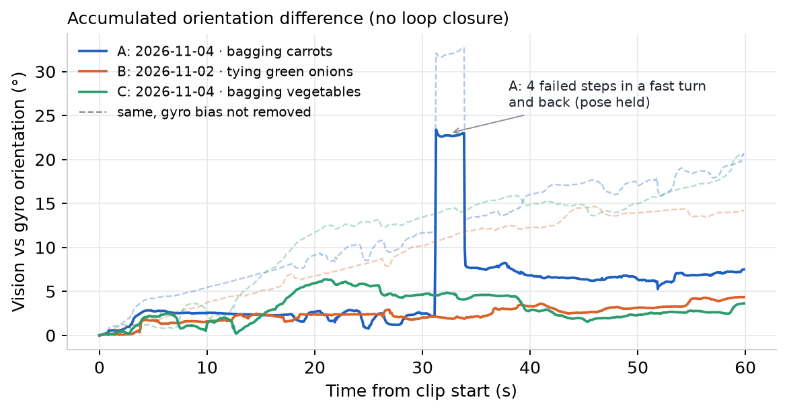
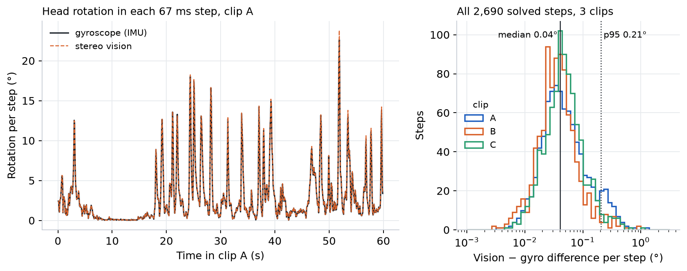
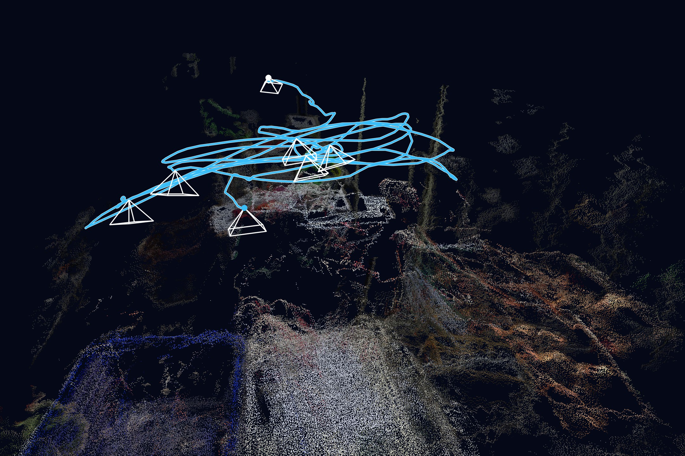

<!-- ODL_QUALITY_V2 -->

# Origin Data Lab · Technical Field Note #21

**ODL Stereo VO Checked With IMU**

[](https://github.com/origin-data-lab/stereo-visual-odometry-head-pose-imu-validation-real-work) [](https://huggingface.co/datasets/origin-data-lab/stereo-visual-odometry-head-pose-imu-validation-real-work) [](https://www.kaggle.com/datasets/origindatalab/odl-stereo-vo-checked-with-imu) [](https://origindatalab.io/technical-field-notes/stereo-visual-odometry-head-pose-imu-validation-real-work.html)

[English technical note](https://origindatalab.io/technical-field-notes/stereo-visual-odometry-head-pose-imu-validation-real-work.html) | [Korean technical note](https://origindatalab.io/ko/technical-field-notes/stereo-visual-odometry-head-pose-imu-validation-real-work.html)

---

# ODL Field Note #21 — Stereo visual odometry on real egocentric work, checked with the gyroscope and accelerometer
```bash
pip install numpy pandas scipy opencv-contrib-python-headless pyyaml matplotlib imageio-ffmpeg
python3 analysis/vo.py <clip_prefix> 0 59.9 2       # stereo VO, vision only (needs the stereo clip + IMU CSV)
python3 analysis/vo_eval.py                        # rotation vs gyro, acceleration vs accelerometer, drift -> tables
python3 analysis/fn21_figs.py                      # figures from the tables
```
Included: per-step rotation (2694 steps), drift curves, smoothed acceleration series and per-clip summary for three 60 s real-work clips. Images and raw recordings are not distributed.
Licence: Creative Commons Attribution 4.0 International (CC BY 4.0) for derived data and figures; MIT for code.

<!-- ODL_ENTITY_V1 -->
## About Origin Data Lab

**Origin Data Lab** (origindatalab.io, OriginDataLab Co., Ltd.) is a real-world data collection company based in **Yangyang, Gangwon State, South Korea**. We plan and run egocentric, stereo+IMU and field video capture for physical AI and robotics teams, with documented QA such as the measurements in this dataset. Not affiliated with "Origin Lab" (game data) or "OriginLab" (Origin/OriginPro software).

- **[Request sample data](https://origindatalab.io/contact.html?topic=sample&note=fn21&utm_source=github&utm_medium=referral&utm_campaign=field-notes)**: stereo+IMU or phone+IMU egocentric capture
- **[Custom data collection](https://origindatalab.io/data-services.html?utm_source=github&utm_medium=referral)**: field capture in South Korea and Bangladesh
- **[All technical field notes](https://origindatalab.io/technical-field-notes/?utm_source=github&utm_medium=referral)**

## Visual evidence

Figures are taken from the released technical-note package. Interpret with the original methods and limitations.

### Figure 1



*Left: acceleration on the axis with the most motion in clip A, both band-passed the same way. Right: all filtered samples, three axes, three clips; the line marks equality.*

### Figure 2



*Accumulated orientation difference between vision and the integrated gyroscope from the start of each clip; solid: gyroscope bias from Field Note #14 removed, dashed: raw gyroscope.*

### Figure 3



*Left: rotation per 67 ms step in clip A, gyroscope (solid) and stereo vision (dashed). Right: vision − gyroscope difference for every solved step, three clips.*

### Figure 4



*Clip A, first 36 s: head path and a sparse stereo point cloud (one keyframe per second), gravity-aligned with the accelerometer.*


---

## Explore Origin Data Lab

[](https://github.com/origin-data-lab/stereo-visual-odometry-head-pose-imu-validation-real-work) [](https://huggingface.co/datasets/origin-data-lab/stereo-visual-odometry-head-pose-imu-validation-real-work) [](https://www.kaggle.com/datasets/origindatalab/odl-stereo-vo-checked-with-imu) [](https://origindatalab.io/technical-field-notes/stereo-visual-odometry-head-pose-imu-validation-real-work.html)

[Official Website](https://origindatalab.io/) | [Technical Field Notes](https://origindatalab.io/technical-field-notes/) | [English Note](https://origindatalab.io/technical-field-notes/stereo-visual-odometry-head-pose-imu-validation-real-work.html) | [Korean Note](https://origindatalab.io/ko/technical-field-notes/stereo-visual-odometry-head-pose-imu-validation-real-work.html)

[GitHub](https://github.com/origin-data-lab/stereo-visual-odometry-head-pose-imu-validation-real-work) | [Hugging Face](https://huggingface.co/datasets/origin-data-lab/stereo-visual-odometry-head-pose-imu-validation-real-work) | [Kaggle Dataset](https://www.kaggle.com/datasets/origindatalab/odl-stereo-vo-checked-with-imu) | [Kaggle Notebook](https://www.kaggle.com/code/origindatalab/odl-stereo-vo-checked-with-imu-notebook)


## Code availability

Device-specific readers and production pipeline code are withheld; see `CODE_AVAILABILITY.md`. Figures and result tables are complete.
